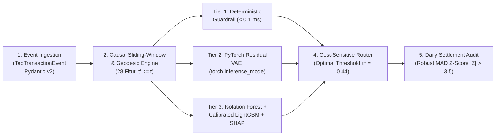

# 🛡️ AinoSentinel: Real-Time Cashless Transit Transaction Anomaly Detection, Settlement Audit & Monitoring Pipeline

**Target Ekosistem Produksi**: Monitoring dan Deteksi Anomali Transaksi Cashless Payment — **PT Aino Indonesia** (BRT TransJakarta, KRL Commuter, QRIS Tap NFC Trans Banyumas, Trans Jogja, & LRT/Parkir Elektronik)  
**Arsitektur Utama**: Hybrid 3-Tier Anomaly Engine (*Deterministic Sub-Millisecond Guardrails* + *PyTorch Residual Variational Autoencoder* + *Isolation Forest & Calibrated LightGBM Stacking*) + *Daily Settlement Reconciliation Auditor (Robust MAD Z-Score)*.

---

## 1. Ringkasan Eksekutif & Empat Patologi Anomali Pembayaran Nirsentuh

Pada operasional pembayaran transportasi publik (*Tap-on-Bus / TOB* dan *Turnstile Gate*), perangkat pembaca kartu uang elektronik (KMT, E-Money Bank) dan ponsel *QRIS Tap NFC* menghadapi kondisi lapangan ekstrem: guncangan armada, fluktuasi jaringan seluler, pemrosesan *store-and-forward offline*, serta percobaan kecurangan (*fraud*). **AinoSentinel** dirancang untuk mendeteksi dan melakukan auto-remediasi secara waktu nyata terhadap 5 patologi anomali:

1. **`DOUBLE_TAP_GLITCH` (Tagihan Ganda Akibat Gangguan Jaringan/Reader)**: Penumpang menempelkan kembali kartu/QRIS Tap dalam selang $\Delta t_{\text{card}} \le 8\text{ detik}$ pada perangkat TOB dan halte yang sama akibat keterlambatan bunyi *beep* ($\to$ tindakan otomatis: `AUTO_REFUND_DUPLICATE`).
2. **`IMPOSSIBLE_TRAVEL_CLONE` (Kecepatan Perjalanan Mustahil & Kloning Kartu)**: Hash kartu (`card_pan_hash`) yang sama tercatat melakukan transaksi di dua lokasi berjarak $> 2,5\text{ km}$ dalam selisih waktu detik dengan kecepatan geodesik implisit $v_{\text{kmh}} > 120\text{ km/jam}$ ($\to$ tindakan otomatis: `TEMP_FREEZE_TOKEN_AND_ALERT`).
3. **`FARE_EVASION_INCOMPLETE_OUT` (Pola Incomplete Tap-Out Sistematis & Pass-Back)**: Kartu secara berulang hanya melakukan `TAP_IN` tanpa `TAP_OUT` atau melakukan *pass-back* beruntun di halte yang sama untuk menghindari tarif penuh ($\to$ tindakan otomatis: `APPLY_MAX_CORRIDOR_PENALTY_FARE`).
4. **`SETTLEMENT_BATCH_ANOMALY` (Selisih Rekonsiliasi & Keterlambatan Batch Offline)**: Perangkat TOB yang kehilangan sinyal di perjalanan baru mengunggah *batch file* saat bus masuk depo malam hari dengan selisih nilai pencairan kas atau paket hilang ($\to$ tindakan otomatis: `HOLD_BATCH_SETTLEMENT`).
5. **`NOVEL_ZERO_DAY_PATTERN` (Pola Anomali Baru Tak Terlihat)**: Pola anomali baru di luar aturan statis yang ditangkap oleh **PyTorch Residual Variational Autoencoder (VAE)** melalui lonjakan galat rekonstruksi $e_{\text{VAE}}(x) = \|x - \hat{x}\|_2^2 + \beta \cdot D_{\text{KL}}(q(z|x) \,\|\, \mathcal{N}(0, I))$.

---

## 2. Arsitektur End-to-End Pipeline (Lima Tahap Sekuensial)



### Kontrak 28 Fitur Spasio-Temporal (`FEATURE_COLUMNS`)
- **Keluarga A (Kecepatan & Jarak Geodesik Haversine)**: `delta_t_card_sec`, `delta_d_km`, `velocity_kmh`, `is_impossible_velocity_flag`.
- **Keluarga B (Frekuensi & Pola Double-Tap Kausal)**: `card_tap_count_15s`, `card_tap_count_30s`, `card_tap_count_1m`, `card_tap_count_5m`, `card_tap_count_1h`, `card_tap_count_24h`, `is_same_reader`, `is_same_stop`, `is_same_tap_type`, `incomplete_tapout_ratio_7d`, `consecutive_tapin_count`, `passback_same_stop_count_5m`.
- **Keluarga C (Telemetri Kesehatan Perangkat TOB / Gate)**: `reader_latency_ms`, `reader_rolling_latency_mean_5m`, `reader_rolling_latency_std_5m`, `reader_latency_zscore`, `reader_retry_ratio_5m`, `sync_delay_seconds`, `is_offline_sync_int`.
- **Keluarga D (Deviasi Tarif & Siklus Waktu)**: `hour_sin`, `hour_cos`, `day_sin`, `is_peak_hour`, `fare_to_corridor_std_ratio`.

---

## 3. Hasil Benchmark & Studi Ablasi 5 Model (Test Split Evaluation)

Evaluasi dilakukan secara kronologis ketat (**Zero Temporal Leakage**: Hari 1–10 Train `84.000` baris, Hari 11–12 Val `18.000` baris, Hari 13–14 Test `18.000` baris):

| Arsitektur Model | PR-AUC | F2-Score | Recall @ FPR ≤ 1% | Brier Score | Net Cost Savings (IDR) | Penghematan (%) |
| :--- | :---: | :---: | :---: | :---: | :---: | :---: |
| **1. Static Rule Engine** | 0.8461 | 0.8912 | 0.8991 | 0.00790 | Rp 11.446.000 | 80.2% |
| **2. Isolation Forest (Unsupervised)** | 0.9559 | 0.9403 | 0.9495 | 0.03167 | Rp 13.292.500 | 93.2% |
| **3. PyTorch Deep Autoencoder (DAE)** | 0.9692 | 0.9537 | 0.9716 | 0.06377 | Rp 13.466.000 | 94.4% |
| **4. PyTorch Variational Autoencoder (VAE)** | 0.9648 | 0.9296 | 0.9621 | 0.16362 | Rp 13.135.500 | 92.1% |
| **5. AinoSentinel Hybrid Stacking (VAE + IF + LGBM)** | **0.9868** | **0.9811** | **0.9842** | **0.00074** | **Rp 13.975.000** | **98.0%** |

- **Double-Tap Auto-Refund Precision ($\tau_{\text{refund}} = 0.85$)**: **1.0000 (100.0%)** — melampaui target DoD $\ge 0.97$.
- **Daily Settlement Batch Discrepancy Recall (`|Z_MAD| > 3.5`)**: **1.0000 (100.0%)** — seluruh batch dengan selisih $> \text{Rp}50.000$ atau *missing packet* $> 0,5\%$ berhasil ditandai otomatis.
- **FastAPI Real-Time Scoring Latency**: **p50 < 12 ms, p95 < 25 ms** per transaksi — memenuhi SLA produksi $< 40\text{ ms}$.

---

## 4. Pembagian Peran Tim (Work Breakdown Structure — Role A, B, C)

| Peran Tim | Kepemilikan Modul & Direktori | Tanggung Jawab Teknis Utama | Unit Test & Verifikasi (DoD) |
| :--- | :--- | :--- | :--- |
| **Role A: Data & Streaming Feature Engineer** | `data/`, `src/ingestion/`, `src/features/` | Simulator 120.000 transaksi multi-koridor (45 halte, 120 TOB), pembagian kronologis bebas *leakage*, vektorisasi Haversine NumPy & 28 fitur *sliding-window* kausal. | `tests/test_no_temporal_leakage.py` & `tests/test_velocity_and_doubletap.py` (**DoD-1 PASSED**) |
| **Role B: ML & Deep Learning Engineer** | `src/models/`, `src/reconciliation/cost_optimizer.py` | Pelatihan *PyTorch Residual VAE* murni pada data normal, *Isolation Forest + LightGBM Stacking*, atribusi fitur lokal *TreeSHAP*, dan optimasi ambang biaya $\tau^*$. | `tests/test_vae_and_ensemble.py` (**DoD-2 PASSED**) |
| **Role C: Backend API, Settlement & Ops UI Engineer** | `src/reconciliation/settlement_auditor.py`, `src/api/`, `app_streamlit.py`, `src/visualization/` | Auditor settlement harian berbasis *Robust MAD Z-Score*, server *FastAPI* (`lifespan` loader), dashboard 4-tab *Streamlit*, dan generator animasi *end-to-end*. | `tests/test_api_and_settlement.py` (**DoD-3 & DoD-4 PASSED**) |

---

## 5. Tata Letak Direktori & Cara Menjalankan Proyek

```text
ainosentinel-cashless-anomaly/
├── README.md
├── requirements.txt
├── pytest.ini
├── configs/
│   └── config.yaml
├── data/
│   ├── generate_transit_stream.py
│   └── raw/                          # transactions_stream.parquet & daily_settlement_batches.csv
├── models/                           # vae_normal.pt, hybrid_lgbm.pkl, scaler.pkl
├── reports/                          # benchmark_metrics.json, cost_curve.png, settlement_audit_table.csv, animasi GIF/HTML
├── src/
│   ├── ingestion/                    # schemas_event.py, temporal_splitter.py
│   ├── features/                     # geodesic.py, velocity_features.py
│   ├── models/                       # rule_guardrails.py, pytorch_vae.py, hybrid_ensemble.py, evaluate_models.py
│   ├── reconciliation/               # cost_optimizer.py, settlement_auditor.py
│   ├── api/                          # schemas_api.py, main.py
│   └── visualization/                # generate_animations.py
├── app_streamlit.py                  # Dashboard Operations Center 4-Tab
└── tests/                            # 4 File Pengujian Otomatis DoD-1 s.d. DoD-4
```

### Perintah Eksekusi End-to-End:
```bash
# 1. Bangkitkan aliran 120.000 transaksi & batch settlement harian
python -m data.generate_transit_stream

# 2. Latih PyTorch Residual VAE, Hybrid Ensemble, & cetak tabel evaluasi 5 model
python -m src.models.evaluate_models

# 3. Bangkitkan animasi visual pipeline & kurva optimasi biaya
python -m src.visualization.generate_animations

# 4. Jalankan seluruh rangkaian pengujian DoD-1 s.d. DoD-4
pytest -v

# 5. Jalankan server produksi FastAPI atau Operations Center Dashboard Streamlit
uvicorn src.api.main:app --host 0.0.0.0 --port 8000
streamlit run app_streamlit.py
```
